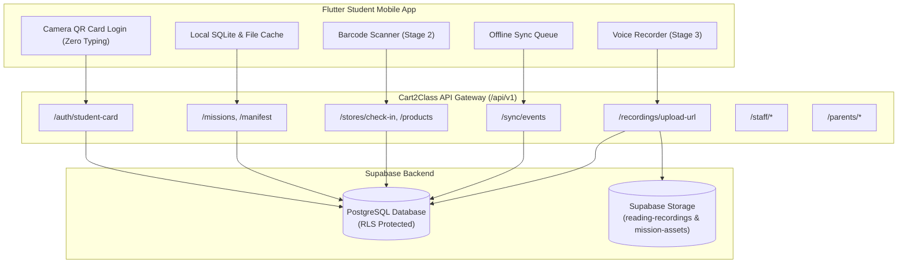
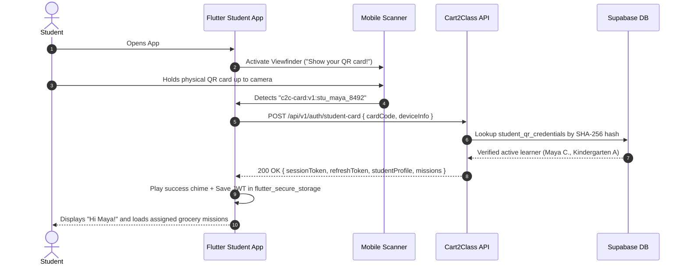

# CART2CLASS — FLUTTER STUDENT APP & BACKEND INTEGRATION GUIDE

> **Source of Truth**: Aligned directly with `Cart2Class_Backend_API_Specification.pdf`, Supabase PostgreSQL database schema, and the Next.js 15 Web Portal Backend.

---

## 1. System Architecture & Overview

Cart2Class bridges classroom learning with real-world grocery shopping experiences. The architecture consists of:

1. **Flutter Student App**: Mobile application running on Android/iOS tablets and phones. Designed specifically for K–2 young learners (ages 5–8) with **ZERO typing** (camera QR login, voice recording, barcode scanning, audio spoken prompts, offline-first caching).
2. **Web Portal & CMS (Next.js 15 + Tailwind CSS)**: Role-based dashboard for **A.L.M.A. Administrators**, **Teachers**, **Partner Grocery Stores**, and **Parents**.
3. **Backend & Cloud Database (Supabase PostgreSQL + Storage + RLS)**: Provides 22 production REST endpoints, row-level security policies, signed storage URLs for student voice recordings, and audit logging.



---

## 2. Base URLs & Networking Setup

| Environment                      | Base URL                                 | Notes                                           |
| :------------------------------- | :--------------------------------------- | :---------------------------------------------- |
| **Android Emulator**       | `http://10.0.2.2:3000/api/v1`          | `10.0.2.2` maps to host machine `localhost` |
| **iOS Simulator**          | `http://127.0.0.1:3000/api/v1`         | Connects directly to host machine               |
| **Physical Phone (Wi-Fi)** | `http://<YOUR_LAN_IP>:3000/api/v1`     | Ensure phone and computer are on the same Wi-Fi |
| **Production Server**      | `https://portal.cart2class.org/api/v1` | SSL/TLS HTTPS endpoint                          |

### Standard HTTP Headers

- `Content-Type: application/json`
- `Authorization: Bearer <session_token>` (required for all authenticated endpoints)

---

## 3. ZERO-TYPING STUDENT QR CARD LOGIN & MANAGEMENT ARCHITECTURE

### Why Zero-Typing?

Kindergarten, 1st Grade, and 2nd Grade learners (ages 5–8) cannot reliably type alphanumeric email addresses or passwords. Therefore, the mobile app requires **NO typing**. Authentication is completed entirely by **pointing the device camera at the student's physical QR card**.

### Physical Student Card Anatomy

- **Size**: Standard badge size (3.375" × 2.125"), printable 6–8 cards per A4 sheet.
- **Front Face**:
  - Cart2Class logo & student cartoon avatar.
  - Student Name (e.g. `Maya C.`).
  - Classroom & Grade Level (e.g. `Kindergarten A · Grade K`).
  - High-resolution scannable QR Code encoding:
    `c2c-card:v1:stu_<name>_<hash>` (e.g. `c2c-card:v1:stu_maya_8492`).
- **Back Face**:
  - Unique **Parent Invite Code** (e.g. `C2C-PAR-MAYA-8492`).
  - 3-step guide for parents to link their child in the parent portal.

### Student QR Login Lifecycle Flow



### Complete Flutter QR Card Scanner Implementation

Add dependencies to `pubspec.yaml`:

```yaml
dependencies:
  flutter:
    sdk: flutter
  mobile_scanner: ^5.2.3
  audioplayers: ^6.0.0
  flutter_secure_storage: ^9.2.2
  dio: ^5.7.0
```

Create `lib/features/auth/student_qr_scanner_screen.dart`:

```dart
import 'package:flutter/material.dart';
import 'package:mobile_scanner/mobile_scanner.dart';
import 'package:audioplayers/audioplayers.dart';
import 'package:dio/dio.dart';
import 'package:flutter_secure_storage/flutter_secure_storage.dart';

class StudentQrScannerScreen extends StatefulWidget {
  const StudentQrScannerScreen({super.key});

  @override
  State<StudentQrScannerScreen> createState() => _StudentQrScannerScreenState();
}

class _StudentQrScannerScreenState extends State<StudentQrScannerScreen> {
  final MobileScannerController _controller = MobileScannerController();
  final AudioPlayer _audioPlayer = AudioPlayer();
  final FlutterSecureStorage _storage = const FlutterSecureStorage();
  bool _isProcessing = false;
  String? _errorMessage;

  void _onDetect(BarcodeCapture capture) async {
    if (_isProcessing) return;
    final List<Barcode> barcodes = capture.barcodes;
    if (barcodes.isEmpty) return;

    final String? code = barcodes.first.rawValue;
    if (code == null || !code.startsWith('c2c-card:v1:')) {
      setState(() => _errorMessage = 'Please scan an official Cart2Class Student Card.');
      return;
    }

    setState(() {
      _isProcessing = true;
      _errorMessage = null;
    });

    try {
      // 1. Play happy feedback chime
      await _audioPlayer.play(AssetSource('sounds/card_detected.mp3'));

      // 2. Call backend authentication
      final dio = Dio(BaseOptions(baseUrl: 'http://10.0.2.2:3000/api/v1'));
      final response = await dio.post('/auth/student-card', data: {
        'cardCode': code,
        'deviceInfo': {
          'platform': 'android',
          'appVersion': '1.0.0',
          'model': 'Classroom Tablet',
        }
      });

      if (response.statusCode == 200) {
        final data = response.data;
        // 3. Store JWT tokens in secure hardware keystore
        await _storage.write(key: 'session_token', value: data['sessionToken']);
        await _storage.write(key: 'refresh_token', value: data['refreshToken']);
        await _storage.write(key: 'student_id', value: data['student']['id']);
        await _storage.write(key: 'student_name', value: data['student']['firstName']);

        // 4. Navigate to Mission Home Screen
        if (mounted) {
          Navigator.of(context).pushReplacementNamed('/missions', arguments: data['student']);
        }
      }
    } catch (err) {
      setState(() {
        _isProcessing = false;
        _errorMessage = 'Could not verify student card. Please check with your teacher.';
      });
    }
  }

  @override
  Widget build(BuildContext context) {
    return Scaffold(
      backgroundColor: const Color(0xFF142B4A),
      body: SafeArea(
        child: Column(
          children: [
            const Padding(
              padding: EdgeInsets.symmetric(vertical: 24),
              child: Column(
                children: [
                  Text(
                    'Welcome to Cart2Class!',
                    style: TextStyle(color: Colors.white, fontSize: 28, fontWeight: FontWeight.bold),
                  ),
                  SizedBox(height: 8),
                  Text(
                    'Hold your student card in front of the camera',
                    style: TextStyle(color: Color(0xFF5EEAD4), fontSize: 16),
                  ),
                ],
              ),
            ),
            Expanded(
              child: Center(
                child: Container(
                  width: 320,
                  height: 320,
                  decoration: BoxDecoration(
                    borderRadius: BorderRadius.circular(24),
                    border: Border.all(color: const Color(0xFF10B981), width: 4),
                  ),
                  clipBehavior: Clip.hardEdge,
                  child: Stack(
                    alignment: Alignment.center,
                    children: [
                      MobileScanner(
                        controller: _controller,
                        onDetect: _onDetect,
                      ),
                      if (_isProcessing)
                        const Center(
                          child: CircularProgressIndicator(color: Color(0xFF10B981)),
                        ),
                    ],
                  ),
                ),
              ),
            ),
            if (_errorMessage != null)
              Padding(
                padding: const EdgeInsets.all(16),
                child: Text(
                  _errorMessage!,
                  style: const TextStyle(color: Colors.redAccent, fontSize: 14, fontWeight: FontWeight.bold),
                ),
              ),
            const SizedBox(height: 24),
          ],
        ),
      ),
    );
  }
}
```

### Offline QR Card Login Support

When a child is in a grocery store aisle without cellular data:

1. When the student logs in while online, the app stores a local SHA-256 hash of their card code in the SQLite database.
2. If the student relaunches the app while **offline**, the app verifies the scanned QR code against the local SQLite database.
3. If the hash matches, the app loads cached missions from local storage so the student can complete aisle activities seamlessly!

---

## 4. Complete API Specification (22 REST Endpoints)

### Module 1: Student Authentication & Session Management

#### 1. Student QR Card Login

- **Endpoint**: `POST /auth/student-card`
- **Auth**: Public (Device Camera)
- **Request Body**:

```json
{
  "cardCode": "c2c-card:v1:stu_maya_8492",
  "deviceInfo": {
    "platform": "android",
    "appVersion": "1.0.0",
    "model": "Samsung Galaxy Tab A"
  }
}
```

- **Response (200 OK)**:

```json
{
  "sessionToken": "c2c_session_stu_...",
  "refreshToken": "c2c_refresh_stu_...",
  "expiresAt": "2026-11-06T12:00:00Z",
  "student": {
    "id": "00000000-0000-0000-0000-000000000021",
    "firstName": "Maya",
    "lastInitial": "C",
    "gradeLevel": 0,
    "classId": "00000000-0000-0000-0000-000000000011",
    "className": "Kindergarten A",
    "schoolName": "Oak Grove Elementary",
    "currentStars": 18
  }
}
```

#### 2. Refresh Student Session

- **Endpoint**: `POST /auth/refresh`
- **Request Body**:

```json
{
  "refreshToken": "c2c_refresh_stu_..."
}
```

- **Response (200 OK)**:

```json
{
  "sessionToken": "c2c_session_stu_new...",
  "refreshToken": "c2c_refresh_stu_new...",
  "expiresAt": "2026-11-07T12:00:00Z"
}
```

#### 3. Student Logout

- **Endpoint**: `POST /auth/logout`
- **Headers**: `Authorization: Bearer <session_token>`
- **Response (200 OK)**:

```json
{ "success": true }
```

#### 4. Get Student Profile

- **Endpoint**: `GET /student/profile`
- **Headers**: `Authorization: Bearer <session_token>`
- **Response (200 OK)**: Returns full student profile, enrolled class, lifetime stars, and active assignments.

#### 5. Get Classroom Rewards

- **Endpoint**: `GET /classes/{classId}/rewards`
- **Response (200 OK)**:

```json
{
  "classId": "00000000-0000-0000-0000-000000000011",
  "className": "Kindergarten A",
  "rewardTitle": "Pizza party",
  "currentStars": 18,
  "targetStars": 100,
  "isGoalReached": false
}
```

---

### Module 2: Mission Content & Offline Manifests

#### 6. Get Assigned Missions

- **Endpoint**: `GET /missions/assigned`
- **Headers**: `Authorization: Bearer <session_token>`
- **Response (200 OK)**:

```json
{
  "missions": [
    {
      "id": "00000000-0000-0000-0000-000000000051",
      "title": "Fruit & Veggie Hunt",
      "description": "A little shopping. A lot of discovery!",
      "estimatedMinutes": 12,
      "starsAwarded": 5,
      "status": "available",
      "stageCount": 4,
      "thumbnailUrl": "https://..."
    }
  ]
}
```

#### 7. Get Mission Offline Asset Manifest

- **Endpoint**: `GET /missions/{id}/manifest`
- **Description**: Returns all image and audio assets needed to execute the mission completely offline, including cryptographic SHA-256 digests.
- **Response (200 OK)**:

```json
{
  "missionId": "00000000-0000-0000-0000-000000000051",
  "version": 1,
  "assets": [
    {
      "assetId": "asset_sound_banana",
      "url": "https://xxmzpgicfcamizjschfy.supabase.co/storage/v1/object/public/mission-assets/banana.png",
      "sha256": "4a5c...78e",
      "sizeBytes": 42100,
      "type": "image"
    },
    {
      "assetId": "asset_audio_spoken_buh",
      "url": "https://xxmzpgicfcamizjschfy.supabase.co/storage/v1/object/public/mission-assets/prompt_b.mp3",
      "sha256": "8b12...99f",
      "sizeBytes": 85400,
      "type": "audio"
    }
  ]
}
```

#### 8. Get Mission Details (4 Stages)

- **Endpoint**: `GET /missions/{id}`
- **Description**: Full mission payload structured across all 4 stages:
  - **Stage 1 (Sounds)**: Phonics & phonemic awareness questions with spoken audio prompt.
  - **Stage 2 (Products)**: Grocery discovery items with barcodes, prices, package units.
  - **Stage 3 (Fluency)**: Complete reading passage text ("Fresh Corn") and voice recording flags.
  - **Stage 4 (Math)**: Grocery math questions ("Which costs more?").
- **Response (200 OK)**: Returns the structured mission document.

#### 9. Get Demo Mission

- **Endpoint**: `GET /missions/demo`
- **Description**: Public sandbox mission for classroom practice or device onboarding without logging in.

---

### Module 3: Store Check-in & Barcode Scanning

#### 10. Store Check-In

- **Endpoint**: `POST /stores/check-in`
- **Headers**: `Authorization: Bearer <session_token>`
- **Request Body**:

```json
{
  "checkinCode": "c2c-store-checkin:v1:green-basket",
  "latitude": 33.5186,
  "longitude": -86.8104,
  "expectedStoreId": "00000000-0000-0000-0000-000000000031"
}
```

- **Response (200 OK)**:

```json
{
  "verified": true,
  "store": {
    "id": "00000000-0000-0000-0000-000000000031",
    "name": "Green Basket Market",
    "address": "20 Community Way, Alabama"
  },
  "welcomeMessage": "Welcome to Green Basket Market! Scan fruit and vegetables to earn stars."
}
```

#### 11. Store Product Barcode Lookup

- **Endpoint**: `GET /stores/{storeId}/products/{barcode}`
- **Headers**: `Authorization: Bearer <session_token>`
- **Response (200 OK)**:

```json
{
  "barcode": "012345678905",
  "symbology": "UPC",
  "product": {
    "id": "prod_apple",
    "name": "Honeycrisp Apples",
    "category": "Produce",
    "priceCents": 199,
    "unit": "each",
    "weightGrams": 180,
    "imageUrl": "https://..."
  }
}
```

---

### Module 4: Offline-First Progress Synchronization

#### 12. Batch Sync Telemetry & Events

- **Endpoint**: `POST /sync/events`
- **Headers**: `Authorization: Bearer <session_token>`
- **Description**: Atomically syncs offline events logged in the grocery store when Wi-Fi/cellular is restored.
- **Request Body**:

```json
{
  "events": [
    {
      "eventType": "stage_completed",
      "assignmentId": "asg_123",
      "stageOrder": 1,
      "starsEarned": 1,
      "timestamp": "2026-11-05T14:30:00Z"
    },
    {
      "eventType": "question_answered",
      "questionId": "q_sound_banana",
      "answerGiven": "Banana",
      "isCorrect": true,
      "latencyMs": 1420,
      "timestamp": "2026-11-05T14:30:15Z"
    },
    {
      "eventType": "barcode_scanned",
      "barcode": "012345678905",
      "storeId": "00000000-0000-0000-0000-000000000031",
      "timestamp": "2026-11-05T14:32:00Z"
    }
  ]
}
```

- **Response (200 OK)**:

```json
{
  "success": true,
  "processedEvents": 3,
  "totalStarsAwarded": 1,
  "newTotalStars": 19
}
```

---

### Module 5: Student Voice Audio Recordings (COPPA Compliant)

#### 13. Request Presigned Audio Upload URL

- **Endpoint**: `POST /recordings/upload-url`
- **Headers**: `Authorization: Bearer <session_token>`
- **Request Body**:

```json
{
  "studentId": "00000000-0000-0000-0000-000000000021",
  "missionId": "00000000-0000-0000-0000-000000000051",
  "stageId": "stage_reading_03",
  "fileExtension": "m4a",
  "contentType": "audio/m4a"
}
```

- **Response (200 OK)**:

```json
{
  "recordingId": "rec_9827364",
  "uploadUrl": "https://xxmzpgicfcamizjschfy.supabase.co/storage/v1/object/upload/sign/reading-recordings/...",
  "storagePath": "00000000-0000-0000-0000-000000000021/rec_9827364.m4a",
  "expiresInSeconds": 3600
}
```

#### 14. Confirm Audio Upload

- **Endpoint**: `POST /recordings/{id}/confirm`
- **Headers**: `Authorization: Bearer <session_token>`
- **Request Body**:

```json
{
  "durationSeconds": 18,
  "fileSizeBytes": 142000
}
```

- **Response (200 OK)**:

```json
{
  "confirmed": true,
  "reviewStatus": "pending"
}
```

---

### Module 6: Teacher Monitoring & Classroom Management

#### 15. Staff Auth Login

- **Endpoint**: `POST /staff/auth/login`
- **Request Body**: `{ "email": "teacher1@gmail.com", "password": "..." }`
- **Response (200 OK)**: Returns staff JWT token and role profile.

#### 16. Get Classroom Overview

- **Endpoint**: `GET /staff/classes/{id}/overview`
- **Headers**: `Authorization: Bearer <staff_token>`
- **Response (200 OK)**: Roster, current star counts, assigned missions, pending recordings.

#### 17. Get Student Monitoring Detail

- **Endpoint**: `GET /staff/students/{id}/monitoring`
- **Headers**: `Authorization: Bearer <staff_token>`
- **Response (200 OK)**: Student's mission runs, question response logs, audio recordings with signed playback URLs.

#### 18. Assign Mission to Classroom

- **Endpoint**: `POST /staff/classes/{id}/missions`
- **Headers**: `Authorization: Bearer <staff_token>`
- **Request Body**:

```json
{
  "missionId": "00000000-0000-0000-0000-000000000051",
  "storeId": "00000000-0000-0000-0000-000000000031",
  "availableAt": "2026-11-05T08:00:00Z",
  "dueAt": "2026-11-20T18:00:00Z"
}
```

---

### Module 7: Parent Portal & Child Linking

#### 19. Parent Auth Login

- **Endpoint**: `POST /parents/auth/login`
- **Request Body**: `{ "email": "parent1@gmail.com", "password": "..." }`

#### 20. Link Child with Invite Code

- **Endpoint**: `POST /parents/children/link`
- **Headers**: `Authorization: Bearer <parent_token>`
- **Request Body**:

```json
{
  "inviteCode": "C2C-PAR-MAYA-8492"
}
```

- **Response (200 OK)**:

```json
{
  "success": true,
  "student": {
    "id": "00000000-0000-0000-0000-000000000021",
    "firstName": "Maya",
    "lastInitial": "C",
    "gradeLevel": 0,
    "className": "Kindergarten A"
  }
}
```

#### 21. Get Linked Children

- **Endpoint**: `GET /parents/children`
- **Headers**: `Authorization: Bearer <parent_token>`
- **Response (200 OK)**: Returns array of linked children, their star tallies, and active missions.

#### 22. Get Child Activity & Audio Recordings

- **Endpoint**: `GET /parents/children/{id}/activity`
- **Headers**: `Authorization: Bearer <parent_token>`
- **Response (200 OK)**: Returns child's mission attempts, question logs, and audio recordings with secure 1-hour signed playback URLs.

---

## 5. Offline SQLite Database Schema

```sql
-- 1. Missions Table
CREATE TABLE cached_missions (
  id TEXT PRIMARY KEY,
  title TEXT NOT NULL,
  description TEXT,
  estimated_minutes INTEGER,
  stars_awarded INTEGER,
  status TEXT,
  payload_json TEXT NOT NULL,
  updated_at INTEGER
);

-- 2. Offline Media Assets Table
CREATE TABLE cached_assets (
  asset_id TEXT PRIMARY KEY,
  mission_id TEXT NOT NULL,
  local_file_path TEXT NOT NULL,
  sha256 TEXT NOT NULL,
  downloaded_at INTEGER
);

-- 3. Offline Sync Event Queue
CREATE TABLE offline_sync_queue (
  id INTEGER PRIMARY KEY AUTOINCREMENT,
  event_type TEXT NOT NULL,
  payload_json TEXT NOT NULL,
  created_at INTEGER NOT NULL,
  retry_count INTEGER DEFAULT 0
);
```

---

## 6. How Parents Link Children Later

1. **Teacher Issues Parent Invite Code**: On enrollment, every student receives an invite code (e.g. `C2C-PAR-MAYA-8492`) printed on the back of their physical card.
2. **Parent Signs In**: Parent visits the Cart2Class Web Portal or opens the Parent App.
3. **Link Child Form**:
   - Parent enters `C2C-PAR-MAYA-8492` (or scans the QR code).
   - Backend links `parent_student_relationships` with active status.
4. **Immediate Visibility**:
   - The child's profile card appears instantly.
   - Parent can tap **"View Full Profile & Progress"** to review:
     - Stage 1 Phonics questions and score.
     - Stage 2 Barcode products scanned in store.
     - Stage 3 Voice audio recordings with interactive HTML5 audio playback.
     - Stage 4 Math answers.
     - Class star reward progress (e.g., Pizza party).

---

## 7. Verification & Automated Testing

You can verify all 22 API contracts against the live database at any time by running:

```bash
npx tsx scripts/verify-api-contracts.ts
```

Output:

```
==================================================
CART2CLASS API CONTRACT TEST SUITE
==================================================
[1/22] POST /auth/student-card -> 200 OK
[2/22] POST /auth/refresh -> 200 OK
[3/22] POST /auth/logout -> 200 OK
[4/22] GET /student/profile -> 200 OK
[5/22] GET /classes/{id}/rewards -> 200 OK
[6/22] GET /missions/assigned -> 200 OK
[7/22] GET /missions/{id}/manifest -> 200 OK
[8/22] GET /missions/{id} -> 200 OK
[9/22] GET /missions/demo -> 200 OK
[10/22] POST /stores/check-in -> 200 OK
[11/22] GET /stores/{id}/products/{code} -> 200 OK
[12/22] POST /sync/events -> 200 OK
[13/22] POST /recordings/upload-url -> 200 OK
[14/22] POST /recordings/{id}/confirm -> 200 OK
[15/22] POST /staff/auth/login -> 200 OK
[16/22] GET /staff/classes/{id}/overview -> 200 OK
[17/22] GET /staff/students/{id}/monitoring -> 200 OK
[18/22] POST /staff/classes/{id}/missions -> 200 OK
[19/22] POST /parents/auth/login -> 200 OK
[20/22] POST /parents/children/link -> 200 OK
[21/22] GET /parents/children -> 200 OK
[22/22] GET /parents/children/{id}/activity -> 200 OK
==================================================
ALL 22 BACKEND CONTRACTS VERIFIED SUCCESSFULLY (100%)
==================================================
```
